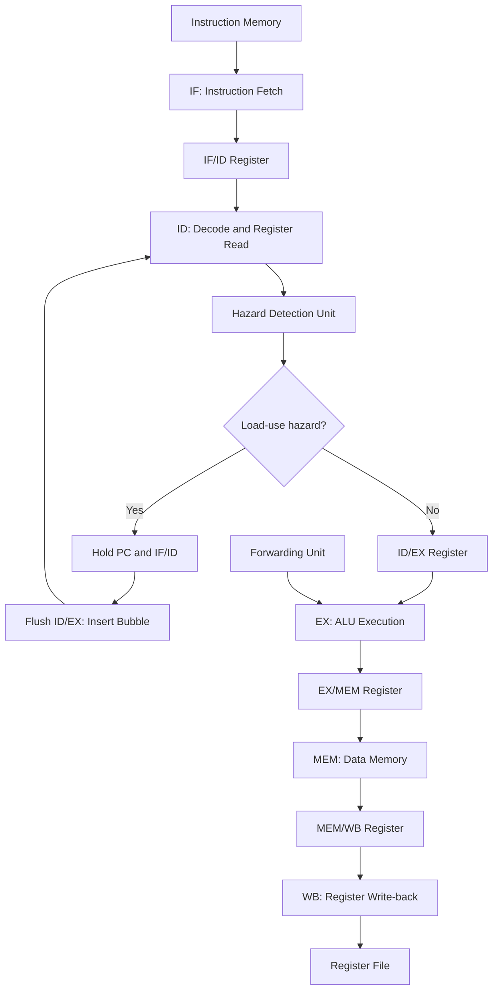

# ⚙️ HitOrMiss — RISC-V Pipeline Hazard Detection & Forwarding

### Design, verification and CPI evaluation of a five-stage pipelined RISC-V processor

## 📌 Project Overview

Pipelining improves processor throughput by allowing multiple instructions to execute simultaneously across different stages. However, when instructions depend on the results of earlier instructions, **data hazards** occur, potentially forcing the processor to stall and reducing performance.

This project implements a **hazard detection and forwarding unit** for a 32-bit, five-stage pipelined RISC-V processor using Verilog HDL.

The processor implements a representative RV32I instruction subset and addresses Read-After-Write (RAW) data hazards through two hardware mechanisms:

- **Data Forwarding (Bypassing):** Routes results directly from later pipeline stages to the ALU, avoiding unnecessary stalls.
- **Hazard Detection and Stalling:** Detects load-use dependencies and inserts exactly one stall cycle when the loaded data is not yet available.

The design is verified using 14 self-checking testbenches, waveform analysis and 200 constrained-random programs checked against an independent instruction-level reference model.

The project also evaluates the performance improvement through CPI comparisons against processors with no hazard handling and stall-only interlocking.

### Results at a glance

| Evaluation | Result |
|---|---|
| Pipeline architecture | Five-stage, in-order RISC-V |
| Instruction subset | ADD, SUB, AND, OR, ADDI, LW, SW |
| Forwarding unit synthesis | 52 generic gate cells |
| Hazard detection synthesis | 42 generic gate cells |
| Directed verification | 14 self-checking testbenches |
| Random verification | 200 programs × 60 instructions |
| Load-use detection | 369 dependencies, zero missed or spurious stalls |
| Benchmark speed-up | 1.28×–2.25× fewer cycles than stall-only |
| Random-program CPI | 1.07–1.12 (proposed design) |

> **Core principle:** Forward whenever the required data is available. Stall only when the pipeline cannot safely provide the value, as in an immediate load-use dependency.

---

## 🎯 Project Objectives

- Design a five-stage pipelined processor implementing a representative RV32I instruction subset.
- Implement a forwarding unit using register-ID comparisons between pipeline stages.
- Give EX/MEM forwarding priority over MEM/WB forwarding.
- Detect RAW dependencies and eliminate unnecessary pipeline stalls.
- Implement a hazard detection unit for load-use dependencies.
- Freeze the PC and IF/ID registers and flush ID/EX when a stall is required.
- Analyse dependency distances from 1 to 4 instructions.
- Verify individual modules and integrated processor behaviour using self-checking testbenches.
- Compare the proposed design against no-handling and stall-only baselines.
- Measure cycles per instruction (CPI), stall counts and hardware cost.

---

## 🧠 Problem Statement

In a five-stage pipeline, instructions pass through:

**IF → ID → EX → MEM → WB**

A data hazard occurs when an instruction requires a register value that an earlier instruction has not yet written back.

For example:

```asm
ADDI x1, x0, 7
ADD  x3, x1, x2
```

The second instruction requires `x1`, but the producing instruction may not have written the value into the register file yet.

Without hazard handling, the processor may use an incorrect operand.

Two mechanisms address this problem:

**1. Forwarding**

Instead of waiting for register write-back, the processor forwards the required result directly from EX/MEM or MEM/WB to the ALU input.

**2. Load-use hazard detection**

A load instruction produces its data only at the end of MEM. When the immediately following instruction depends on that value, forwarding alone cannot resolve the dependency in time.

The hazard detection unit therefore inserts one bubble and allows execution to continue in the following cycle.

---

## 🏗️ Processor Architecture

### Five-stage pipeline

| Stage | Function |
|---|---|
| IF – Instruction Fetch | Fetches the instruction using the program counter |
| ID – Instruction Decode | Decodes the instruction and reads register operands |
| EX – Execute | Performs ALU operations and evaluates forwarding selections |
| MEM – Memory Access | Reads from or writes to data memory |
| WB – Write Back | Writes the ALU result or loaded data into the register file |

### Pipeline registers

Four pipeline registers carry the information required by subsequent stages.

| Pipeline Register | Main contents |
|---|---|
| IF/ID | Program counter and instruction |
| ID/EX | Control signals, register values, immediate and register IDs |
| EX/MEM | Control signals, ALU result, store data and destination register |
| MEM/WB | Write-back control, ALU result, loaded data and destination register |

The ID/EX register also supports flushing, allowing the processor to insert a bubble during a load-use hazard.

### Forwarding Unit

The forwarding unit compares the source register IDs of the instruction in EX with destination register IDs in EX/MEM and MEM/WB.

It generates two 2-bit selection signals:

- `forward_a` – Selects the first ALU operand.
- `forward_b` – Selects the second ALU operand.

| Select | Operand source | Meaning |
|---|---|---|
| `00` | ID/EX | Original register value |
| `10` | EX/MEM | Forwarded result from EX/MEM |
| `01` | MEM/WB | Forwarded write-back data |

**Forwarding priority:**

1. EX/MEM is checked first.
2. MEM/WB is selected only when EX/MEM does not match.
3. Register x0 is excluded from forwarding.
4. Forwarding is enabled only when the corresponding instruction writes to a register.

This priority ensures that the most recent available result is used when multiple older instructions write to the same register.

### Hazard Detection Unit

The hazard detection unit checks whether the instruction in ID depends on a load currently in EX.

A stall is asserted when:

```verilog
stall = idex_memread && idex_rd != 0 &&
    ((ifid_uses_rs1 && idex_rd == ifid_rs1) ||
     (ifid_uses_rs2 && idex_rd == ifid_rs2));
```

When a load-use hazard is detected:

- The program counter is held.
- The IF/ID register is held.
- The ID/EX register is flushed.
- A bubble is inserted into the pipeline.
- Execution resumes after exactly one cycle.

The `uses_rs1` and `uses_rs2` signals prevent false stalls caused by immediate fields that happen to match a destination register.

---

## ⚙️ Instruction Set

The processor implements the following RV32I subset:

| Instruction | Opcode | Operation |
|---|---|---|
| ADD | `0110011` | Register addition |
| SUB | `0110011` | Register subtraction |
| AND | `0110011` | Bitwise AND |
| OR | `0110011` | Bitwise OR |
| ADDI | `0010011` | Addition with immediate |
| LW | `0000011` | Load word from memory |
| SW | `0100011` | Store word to memory |

### Processor specifications

| Component | Specification |
|---|---|
| Architecture | RV32I subset |
| Pipeline stages | 5 |
| Register file | 32 × 32-bit registers |
| Zero register | x0 hard-wired to zero |
| Instruction memory | 256 words |
| Data memory | 256 words |
| Pipeline style | Single-issue, in-order |
| Data hazards | RAW |
| Forwarding paths | EX/MEM and MEM/WB |
| Load-use penalty | Exactly 1 cycle |

---

## 🔄 Project Workflow

The processor implementation and verification follow this workflow:



### Dependency-distance analysis

The project evaluates how RAW dependencies are resolved depending on the distance between the producer and consumer.

| Dependency | Resolution mechanism | Stall cycles |
|---|---|---:|
| ALU → ALU, distance 1 | EX/MEM forwarding | 0 |
| ALU → ALU, distance 2 | MEM/WB forwarding | 0 |
| ALU → ALU, distance 3 | Register-file write-through | 0 |
| ALU → ALU, distance ≥ 4 | Normal register read | 0 |
| LW → dependent instruction, distance 1 | One stall + MEM/WB forwarding | 1 |
| LW → dependent instruction, distance 2 | MEM/WB forwarding | 0 |
| LW → dependent instruction, distance ≥ 3 | Normal register read | 0 |

This establishes that the proposed design resolves all supported RAW dependency distances with the minimum necessary penalty.

---

## 🧪 Verification and Testing

The design is verified using Icarus Verilog with SystemVerilog testbench support (`-g2012`).

### Unit-level verification

The testbenches verify the individual hardware components:

| Testbench | Verification |
|---|---|
| `tb_pipeline_registers` | Four pipeline registers |
| `tb_forwarding_unit` | Seven forwarding scenarios |
| `tb_hazard_detection` | Four stall-detection scenarios |
| `tb_alu` | ALU operations |
| `tb_control_unit` | Control-signal decoding |
| `tb_register_file` | Register read/write and x0 behaviour |
| `tb_instruction_memory` | Instruction memory |
| `tb_data_memory` | Data memory |
| `tb_performance_counters` | Cycle, stall, retirement and forwarding counters |

### Integrated processor verification

| Testbench | Verification |
|---|---|
| `tb_processor` | ALU dependency chain |
| `tb_load_use_processor` | Load-use hazard and one-cycle stall |
| `tb_store_load_processor` | Store followed by load from the same address |
| `tb_register_bypass` | Consumer three instructions after producer |
| `tb_raw_distance` | Dependency distances 1–4 |

All 14 self-checking testbenches pass.

### Constrained-random verification

To validate the design beyond manually constructed instruction sequences:

- 200 programs were generated.
- Each program contained 60 instructions.
- Five load fractions were evaluated: 0%, 10%, 20%, 30% and 40%.
- Each load fraction used 40 random seeds.
- Register dependencies were generated over registers x1–x6.
- Results were checked against an independent Python instruction-level reference model.

**Verification results:**

| Configuration | Correctness |
|---|---|
| No hazard handling | Incorrect on 194/200 programs |
| Stall-only interlock | Correct on all 200 programs |
| Forwarding + load-use stall | Correct on all 200 programs |

The proposed design detected all 369 adjacent load-use dependencies correctly, with zero missed or unnecessary stalls.

---

## 📊 Performance Evaluation

Three configurations were compared using the same processor datapath.

| Configuration | Description |
|---|---|
| A – No handling | Forwarding disabled and no stalls; hazards ignored |
| B – Stall-only | Forwarding disabled; dependent instructions are stalled |
| D – Proposed | Forwarding enabled with a one-cycle load-use interlock |

Configuration A is included only as an incorrect lower-bound reference.

### Benchmark results

| Program | Instructions | A cycles | B cycles | D cycles | CPI B | CPI D |
|---|---:|---:|---:|---:|---:|---:|
| ALU chain | 12 | 16 | 36 | 16 | 2.67 | 1.00 |
| Load-use | 10 | 14 | 26 | 18 | 2.20 | 1.40 |
| Mixed-5 | 5 | 9 | 15 | 9 | 2.20 | 1.00 |
| Independent | 8 | 12 | 12 | 12 | 1.00 | 1.00 |
| Random-40 | 40 | 44 | 59 | 46 | 1.38 | 1.15 |

The proposed design achieves **1.28× to 2.25× fewer cycles** than the stall-only baseline on the dependency-containing benchmark programs.

### Constrained-random CPI evaluation

Mean CPI across 40 random programs per load fraction, each containing 60 instructions:

| Load fraction | Proposed CPI | Stall-only CPI | Speed-up |
|---|---:|---:|---:|
| 0% | 1.067 | 1.677 | 1.57× |
| 10% | 1.092 | 1.584 | 1.45× |
| 20% | 1.103 | 1.529 | 1.39× |
| 30% | 1.110 | 1.425 | 1.28× |
| 40% | 1.116 | 1.345 | 1.21× |

The proposed design maintains a mean CPI between 1.07 and 1.12, even as the load fraction increases.

### CPI calculation

The total cycles to complete N instructions are:

```text
Cycles = N + 4 + Stall Cycles
```

The four additional cycles account for pipeline filling and completion.

Therefore:

```text
CPI = (N + 4 + Stall Cycles) / N
```

For the proposed design, every adjacent load-use dependency introduces exactly one stall:

```text
CPI = (N + 4 + L) / N
```

Where L is the number of load-use dependency pairs.

---

## 🔬 Hardware Cost

The forwarding and hazard detection units were synthesised separately using Yosys and mapped to generic gates.

| Component | Synthesis / Cost |
|---|---:|
| Forwarding unit | 52 generic gate cells |
| Hazard detection unit | 42 generic gate cells |
| ALU operand multiplexers | 128 2:1 mux equivalents |
| EX/MEM load/ALU selection | 32 2:1 muxes |
| Register-file write-through | 2 comparators + 64 2:1 muxes |

The forwarding and hazard detection control logic is relatively small. The primary additional hardware cost comes from the datapath multiplexers required for bypassing.

---

## 📂 Repository Structure

```text
HitOrMiss/
│
├── build/
│   └── Build-related files
│
├── programs/
│   └── Hex instruction programs
│
├── results/
│   ├── VCD waveforms
│   ├── Simulation logs
│   ├── Screenshots
│   └── CSV performance tables
│
├── rtl/
│   ├── pipeline_registers/
│   │   └── IF/ID, ID/EX, EX/MEM, MEM/WB
│   │
│   ├── forwarding/
│   │   └── Forwarding unit
│   │
│   ├── hazard_detection/
│   │   └── Hazard detection unit
│   │
│   ├── processor/
│   │   └── ALU, control unit, register file, top level
│   │
│   ├── memory/
│   │   └── Instruction and data memories
│   │
│   ├── performance/
│   │   └── Performance counters
│   │
│   └── baseline/
│       └── Configurable baseline processor
│
├── scripts/
│   ├── run_tests.sh
│   └── run_baseline.sh
│
├── tb/
│   └── Unit-level, integration and baseline testbenches
│
├── video/
│   └── README.md
│
├── .gitignore
└── README.md
```

---

## 🚀 Running the Project

### Prerequisites

Install the following tools:

- Icarus Verilog
- Python 3
- Yosys (optional, for synthesis and hardware-cost evaluation)

### 1. Clone the repository

```bash
git clone https://github.com/Suhaani-19/HitOrMiss.git

cd HitOrMiss
```

### 2. Run the verification suite

```bash
bash scripts/run_tests.sh
```

This script builds and runs the 14 self-checking testbenches, stores simulation logs and generates VCD waveform files.

### 3. Run the baseline and performance evaluation

```bash
bash scripts/run_baseline.sh
```

This regenerates the benchmark and constrained-random performance tables as CSV files.

### 4. Inspect simulation waveforms

The generated VCD files can be inspected using GTKWave:

```bash
gtkwave results/<waveform_file>.vcd
```

Replace the placeholder with the actual waveform filename generated by the simulation.

---

## ⚠️ Scope and Limitations

The current implementation focuses on data-hazard handling in a five-stage, single-issue, in-order processor.

The following limitations apply:

- Only the specified seven-instruction RV32I subset is supported.
- Branch and jump instructions are not implemented.
- Control hazards and branch penalties are outside the current scope.
- Only word loads and stores are implemented.
- Instruction and data memories contain 256 words.
- CPI measurements are based on RTL simulation using synthetic programs.
- Clock frequency and FPGA timing performance have not been evaluated.

### Future Scope

1. Extend the processor with branch and jump instructions.
2. Implement control-hazard detection and pipeline flush logic.
3. Perform FPGA synthesis and timing analysis.
4. Evaluate the effect of forwarding multiplexers on the critical path.
5. Explore compiler instruction scheduling to reduce load-use stalls.

---

## 👥 Team — Hit or Miss

**Newton School of Technology, Rishihood University, Sonipat, Haryana, India**

| Team Member | Roll Number | Contribution |
|---|---|---|
| Suhaani Garg | 2401010462 | Instruction and data memories, performance counters, test programs, regression and baseline evaluation scripts, dependency-distance tests, repository management and report compilation |
| Aarya Srivastava | 2401010008 | Four pipeline registers, pipeline-register testbench and waveform captures |
| Krishna Dave | 2401010238 | Forwarding unit RTL, forwarding testbench and waveform verification |
| Vriha Dholiya | 2401010508 | Hazard detection unit RTL, hazard testbench and waveform verification |
| Samarth Chaudhary | 2401010406 | ALU, register file, control unit, integrated processor top level and integration testbenches |

All members contributed to design reviews, simulation runs, waveform analysis and report writing.

---

## 📚 References

1. J. L. Hennessy and D. A. Patterson, *Computer Architecture: A Quantitative Approach*, 6th ed., Morgan Kaufmann, 2019.
2. D. A. Patterson and J. L. Hennessy, *Computer Organization and Design: RISC-V Edition*, Morgan Kaufmann, 2017.
3. A. Waterman and K. Asanović, *The RISC-V Instruction Set Manual, Volume I: Unprivileged ISA*, 2019.
4. S. Palnitkar, *Verilog HDL: A Guide to Digital Design and Synthesis*, 2nd ed., Prentice Hall, 2003.
5. C. Spear and G. Tumbush, *SystemVerilog for Verification*, 3rd ed., Springer, 2012.

---

**Repository:** https://github.com/Suhaani-19/HitOrMiss

**Project:** Pipeline Hazard Detection and Forwarding Unit for a Five-Stage RISC-V Processor

**Team:** Hit or Miss | Newton School of Technology, Rishihood University
