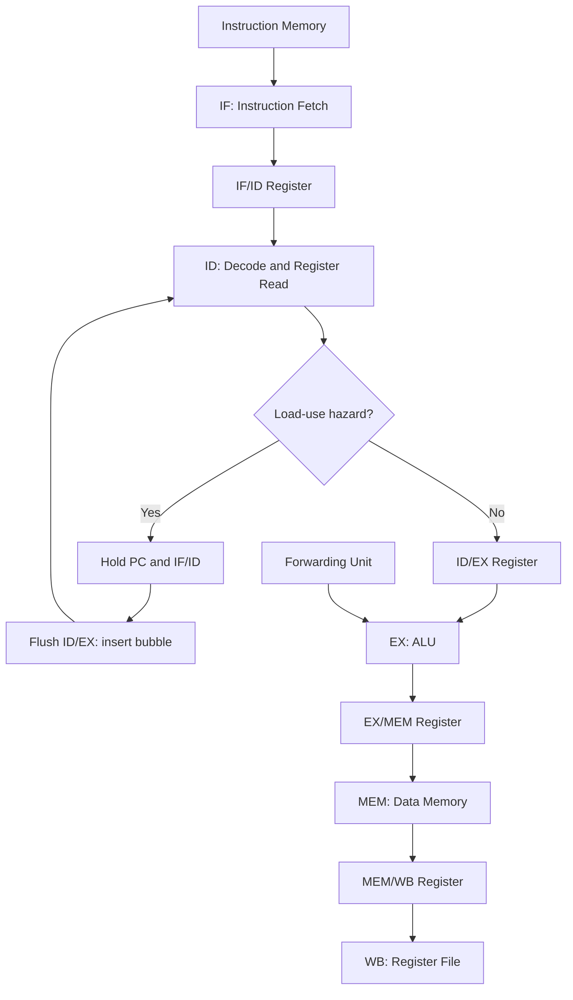

# ⚙️ HitOrMiss — RISC-V Pipeline Hazard Detection & Forwarding


**Design, verification and CPI evaluation of a five-stage pipelined RISC-V processor with data forwarding and load-use hazard detection.**

📄 [IEEE Report](report/HitOrMiss_IEEE_Project_Report.pdf) · 🎥 [Demo Video](https://drive.google.com/file/d/1CEeM6fH5TF-t4aR3ia33J1tofGwibbfM/view?usp=sharing)

---

## 📌 Overview

Pipelining improves processor throughput by executing multiple instructions at once across different stages. When an instruction depends on the result of an earlier one, a **Read-After-Write (RAW) data hazard** occurs and can force stalls.

This project implements a 32-bit, five-stage, in-order RISC-V processor in Verilog that resolves RAW hazards with two hardware mechanisms:

- **Data forwarding (bypassing):** routes results from EX/MEM or MEM/WB directly to the ALU inputs, avoiding unnecessary stalls.
- **Hazard detection and stalling:** detects load-use dependencies and inserts exactly one stall cycle when loaded data is not yet available.

> **Core principle:** forward whenever the data is available; stall only when the pipeline cannot safely provide the value (an immediate load-use dependency).

### Results at a glance

| Item | Result |
|---|---|
| Pipeline | Five-stage, single-issue, in-order |
| Instruction subset | ADD, SUB, AND, OR, ADDI, LW, SW |
| Directed verification | 13 self-checking testbenches, all passing |
| Load-use penalty | Exactly 1 cycle |
| Benchmark speed-up | 1.28×–2.25× fewer cycles than stall-only |
| Random-program CPI | 1.07–1.12 (proposed design) |
| Hardware cost | Forwarding unit 52 and hazard unit 42 generic gate cells (Yosys) |

The performance, constrained-random verification and synthesis results are documented in the [IEEE report](report/HitOrMiss_IEEE_Project_Report.pdf).

---

## 🏗️ Architecture

**IF → ID → EX → MEM → WB**

| Stage | Function |
|---|---|
| IF – Instruction Fetch | Fetches the instruction using the program counter |
| ID – Instruction Decode | Decodes the instruction, reads registers, detects hazards |
| EX – Execute | ALU operation using forwarded operands |
| MEM – Memory Access | Reads from or writes to data memory |
| WB – Write Back | Writes the ALU result or loaded data to the register file |

### Pipeline registers

| Register | Main contents |
|---|---|
| IF/ID | Program counter and instruction |
| ID/EX | Control signals, register values, immediate, register IDs (supports flush) |
| EX/MEM | Control signals, ALU result, store data, destination register |
| MEM/WB | Write-back control, ALU result, loaded data, destination register |

### Forwarding unit

Compares the source register IDs of the instruction in EX with the destination registers in EX/MEM and MEM/WB, and drives two 2-bit selects, `forward_a` and `forward_b`.

| Select | Operand source |
|---|---|
| `00` | ID/EX (original register value) |
| `10` | EX/MEM (forwarded ALU result) |
| `01` | MEM/WB (forwarded write-back data) |

**Priority rules:** EX/MEM is checked first; MEM/WB is used only if EX/MEM does not match; `x0` is never forwarded; forwarding applies only when the producer writes a register.

### Hazard detection unit

```verilog
stall = idex_memread && idex_rd != 0 &&
    ((ifid_uses_rs1 && idex_rd == ifid_rs1) ||
     (ifid_uses_rs2 && idex_rd == ifid_rs2));
```

On a load-use hazard the PC and IF/ID register are held, ID/EX is flushed to insert a bubble, and execution resumes after exactly one cycle. The `uses_rs1` / `uses_rs2` signals prevent false stalls when an immediate field happens to match a destination register.

### Pipeline flow



### Dependency-distance behaviour

| Dependency | Resolution | Stalls |
|---|---|---:|
| ALU → ALU, distance 1 | EX/MEM forwarding | 0 |
| ALU → ALU, distance 2 | MEM/WB forwarding | 0 |
| ALU → ALU, distance 3 | Register-file write-through | 0 |
| ALU → ALU, distance ≥ 4 | Normal register read | 0 |
| LW → use, distance 1 | One stall + MEM/WB forwarding | 1 |
| LW → use, distance 2 | MEM/WB forwarding | 0 |
| LW → use, distance ≥ 3 | Normal register read | 0 |

### Instruction set and specifications

| Instruction | Opcode | Operation |
|---|---|---|
| ADD / SUB / AND / OR | `0110011` | Register arithmetic and logic |
| ADDI | `0010011` | Addition with immediate |
| LW | `0000011` | Load word |
| SW | `0100011` | Store word |

| Component | Specification |
|---|---|
| Register file | 32 × 32-bit, `x0` hard-wired to zero |
| Instruction memory | 256 words |
| Data memory | 256 words |
| Forwarding paths | EX/MEM and MEM/WB |
| Load-use penalty | Exactly 1 cycle |

---

## 📂 Repository Structure

```text
HitOrMiss/
├── build/                    # Compiled testbench executables (generated by iverilog)
├── programs/                 # Hex test programs (load_use, store_load, gap3, mixed_dependencies)
├── report/                   # IEEE project report (PDF)
├── results/
│   ├── simulation_logs/      # Per-testbench logs
│   ├── waveforms/            # VCD waveforms
│   └── screenshots/          # RTL, testbench and waveform screenshots per team member
├── rtl/
│   ├── pipeline_registers/   # IF/ID, ID/EX, EX/MEM, MEM/WB
│   ├── forwarding/           # Forwarding unit
│   ├── hazard_detection/     # Hazard detection unit
│   ├── processor/            # ALU, control unit, register file, top level
│   ├── memory/               # Instruction and data memories
│   └── performance/          # Cycle, stall, retirement and forwarding counters
├── scripts/
│   └── run_tests.sh          # Builds and runs all testbenches
├── tb/                       # Self-checking testbenches
├── video/                    # Demo video link
├── .gitignore
└── README.md
```

---

## 🚀 Running the Project

### Prerequisites

- [Icarus Verilog](https://steveicarus.github.io/iverilog/) (with `-g2012` support)
- [GTKWave](https://gtkwave.sourceforge.net/) (optional, for waveforms)

### Steps

```bash
# 1. Clone
git clone https://github.com/Suhaani-19/HitOrMiss.git
cd HitOrMiss

# 2. Build and run all testbenches
bash scripts/run_tests.sh

# 3. Inspect a waveform
gtkwave results/waveforms/tb_load_use_processor.vcd
```

The script compiles each testbench into `build/`, writes logs to `results/simulation_logs/` and waveforms to `results/waveforms/`.

---

## 🧪 Verification

All testbenches are self-checking and run with Icarus Verilog (`-g2012`).

### Unit-level

| Testbench | Verifies |
|---|---|
| `tb_pipeline_registers` | All four pipeline registers |
| `tb_forwarding_unit` | Forwarding scenarios and EX/MEM priority |
| `tb_hazard_detection` | Stall and no-stall cases |
| `tb_alu` | ALU operations |
| `tb_control_unit` | Control-signal decoding |
| `tb_register_file` | Reads, writes and `x0` behaviour |
| `tb_instruction_memory` | Instruction memory |
| `tb_data_memory` | Data memory |
| `tb_performance_counters` | Cycle, stall, retirement and forwarding counters |

### Integrated processor

| Testbench | Verifies |
|---|---|
| `tb_processor` | ALU dependency chain |
| `tb_load_use_processor` | Load-use hazard with one-cycle stall |
| `tb_store_load_processor` | Store followed by load from the same address |
| `tb_register_bypass` | Consumer three instructions after producer |

---

## 📊 Performance Evaluation

Three configurations were compared on the same datapath:

| Configuration | Description |
|---|---|
| A – No handling | No forwarding, no stalls (incorrect lower-bound reference) |
| B – Stall-only | No forwarding; dependent instructions are stalled |
| D – Proposed | Forwarding plus one-cycle load-use interlock |

| Program | Instructions | A cycles | B cycles | D cycles | CPI B | CPI D |
|---|---:|---:|---:|---:|---:|---:|
| ALU chain | 12 | 16 | 36 | 16 | 2.67 | 1.00 |
| Load-use | 10 | 14 | 26 | 18 | 2.20 | 1.40 |
| Mixed-5 | 5 | 9 | 15 | 9 | 2.20 | 1.00 |
| Independent | 8 | 12 | 12 | 12 | 1.00 | 1.00 |
| Random-40 | 40 | 44 | 59 | 46 | 1.38 | 1.15 |

The proposed design needs **1.28× to 2.25× fewer cycles** than stall-only on dependency-heavy programs.

### Constrained-random CPI

Mean CPI over 40 random 60-instruction programs per load fraction:

| Load fraction | Proposed CPI | Stall-only CPI | Speed-up |
|---|---:|---:|---:|
| 0% | 1.067 | 1.677 | 1.57× |
| 10% | 1.092 | 1.584 | 1.45× |
| 20% | 1.103 | 1.529 | 1.39× |
| 30% | 1.110 | 1.425 | 1.28× |
| 40% | 1.116 | 1.345 | 1.21× |

### CPI model

```text
Cycles = N + 4 + Stall Cycles
CPI    = (N + 4 + L) / N      (L = number of adjacent load-use pairs)
```

### Hardware cost

Synthesised with Yosys to generic gates:

| Component | Cost |
|---|---:|
| Forwarding unit | 52 gate cells |
| Hazard detection unit | 42 gate cells |
| ALU operand multiplexers | 128 2:1 mux equivalents |
| EX/MEM load/ALU selection | 32 2:1 muxes |
| Register-file write-through | 2 comparators + 64 2:1 muxes |

The control logic is small; most of the added cost is the datapath multiplexers needed for bypassing.

---

## ⚠️ Limitations and Future Work

- Only the seven-instruction RV32I subset is supported.
- No branch or jump instructions, so control hazards are out of scope.
- Word loads and stores only; 256-word memories.
- CPI is measured from RTL simulation of synthetic programs; clock frequency and FPGA timing are not evaluated.

**Future work:** add branches and jumps with flush logic, run FPGA synthesis and timing analysis, study the critical-path impact of the forwarding muxes, and explore compiler scheduling to reduce load-use stalls.

---

## 👥 Team — Hit or Miss

**Newton School of Technology, Rishihood University, Sonipat, Haryana, India**

| Member | Roll Number | Contribution |
|---|---|---|
| Suhaani Garg | 2401010462 | Instruction and data memories, performance counters, test programs, regression scripts, dependency-distance tests, repository management, report compilation |
| Aarya Srivastava | 2401010008 | Four pipeline registers, pipeline-register testbench, waveform captures |
| Krishna Dave | 2401010238 | Forwarding unit RTL, forwarding testbench, waveform verification |
| Vriha Dholiya | 2401010508 | Hazard detection unit RTL, hazard testbench, waveform verification |
| Samarth Chaudhary | 2401010406 | ALU, register file, control unit, processor top level, integration testbenches |

All members contributed to design reviews, simulation runs, waveform analysis and report writing.

---

## 📚 References

1. J. L. Hennessy and D. A. Patterson, *Computer Architecture: A Quantitative Approach*, 6th ed., Morgan Kaufmann, 2019.
2. D. A. Patterson and J. L. Hennessy, *Computer Organization and Design: RISC-V Edition*, Morgan Kaufmann, 2017.
3. A. Waterman and K. Asanović, *The RISC-V Instruction Set Manual, Volume I: Unprivileged ISA*, 2019.
4. S. Palnitkar, *Verilog HDL: A Guide to Digital Design and Synthesis*, 2nd ed., Prentice Hall, 2003.
5. C. Spear and G. Tumbush, *SystemVerilog for Verification*, 3rd ed., Springer, 2012.

---

**Repository:** https://github.com/Suhaani-19/HitOrMiss
**Project:** Pipeline Hazard Detection and Forwarding Unit for a Five-Stage RISC-V Processor
**Team:** Hit or Miss | Newton School of Technology, Rishihood University